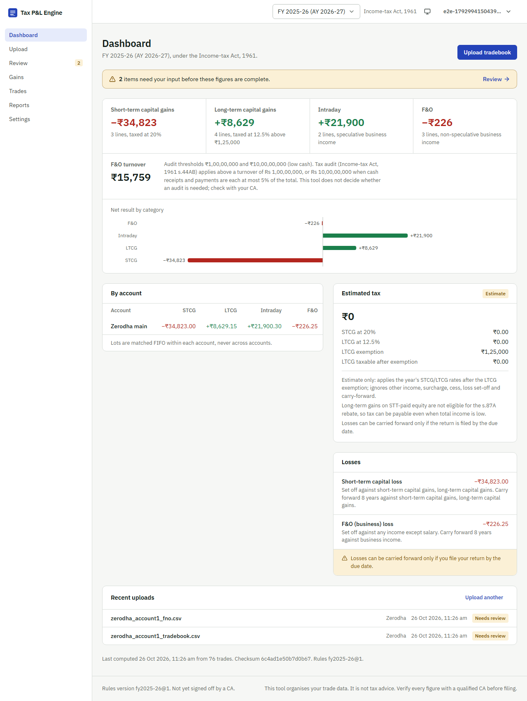
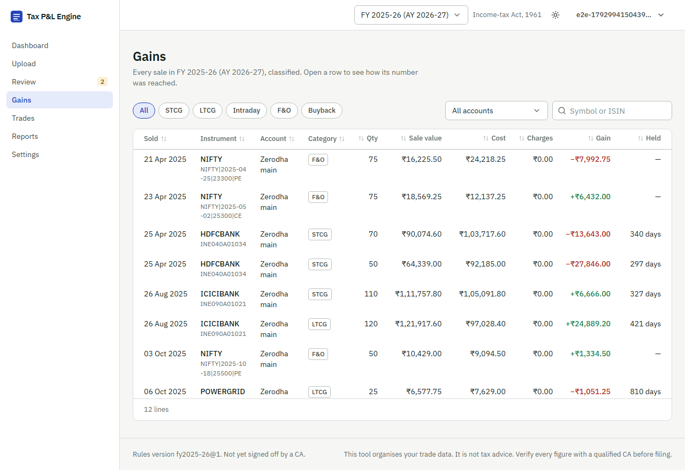
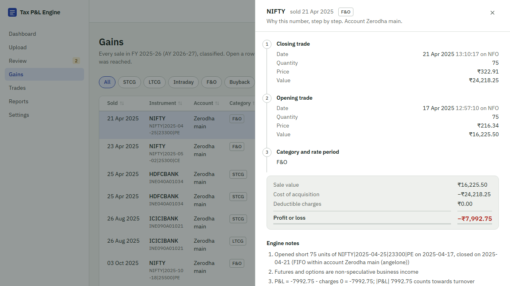

# Tax P&L Engine

Consolidates tradebooks from several Indian brokers (Zerodha, Groww, Upstox, Angel One) into one FIFO-matched, fully explained capital-gains and business-income report for the ITR.

> **Status:** Phases 0-4 built: pure engine, REST API, River pipeline, four broker parsers, React frontend with the Explain drawer, Excel/PDF reports, row-level security, charge estimation, holdings reconciliation, and a first benchmark. Phase 5 (benchmark optimisation, final polish) is in progress. See [TAXPL_BUILD_SPEC.md](TAXPL_BUILD_SPEC.md) for the full plan.



| Gains table | Explain drawer ("why this number?") |
|---|---|
|  |  |

## The problem

Traders in India commonly use two or three broker apps. Each gives its own tax P&L and none of them combine. At filing time the user has to work out which gains are short-term, which are long-term, which trades were intraday or F&O, what cost applies to shares bought before 1 Feb 2018, and what happened after splits, bonuses and demergers. This tool does that work and shows how every number was reached.

## What it does

- Parses **Zerodha, Groww, Upstox and Angel One** tradebooks (CSV or XLSX) into one normalised trade format, auto-detecting the broker and reporting every rejected row with its line number. See [docs/adding-a-broker.md](docs/adding-a-broker.md).
- Applies splits, bonuses, demergers and mergers to lots on their ex-date.
- Matches every sale FIFO **per demat account** (CBDT Circular 768) with partial-lot consumption and same-day intraday netting.
- Classifies every gain: STCG, LTCG, intraday (speculative), F&O (non-speculative), buyback (three dated regimes).
- Applies 31-Jan-2018 grandfathering per lot, including the post-2018 split adjustment most statements get wrong.
- Summarises per year with the rules of that year (FY 2023-24 to Tax Year 2026-27 under the Income-tax Act 2025), F&O turnover per the ICAI Guidance Note, loss set-off and carry-forward rules, and a clearly labelled tax estimate.
- Explains every number: each gain line carries the lots, dates, adjustments, grandfathering comparison and rule references used.

## How correctness is proven

- **35 golden cases** in `backend/testdata/golden/`, each with a hand-computed `expected.json` and a note explaining the arithmetic. See [docs/edge-cases.md](docs/edge-cases.md).
- **Property tests** (`pgregory.net/rapid`) on the matcher: never sells more than bought, lot quantities and costs never negative, cost is conserved to the paisa, FIFO order within a sale, intraday quantity equals min(buy, sell), results independent of input order, accounts independent of each other.
- **Holding-period property test**: the long-term rule is monotonic and agrees with day counts away from the boundary; the boundary itself is pinned by golden cases 04 and 32.
- **Replay**: every golden case runs twice and asserts a byte-identical report checksum.
- **No floats**: a test fails the build if `float32`/`float64` appears in any pure engine package; money is `shopspring/decimal` end to end.
- **Rules are data with sources**: [docs/tax-rules.md](docs/tax-rules.md) lists every rule, its statutory or practitioner source and the test that proves it. Each rules file has a `verified_by` field for the CA's sign-off.
- **Reliability is tested against a real Postgres** (testcontainers): uploading the same file twice adds nothing; a worker interrupted mid-recompute leaves no partial state and the retry completes; three uploads processed concurrently equal three processed one by one; raw files are purged after the TTL while trades stay; "delete my data" removes every row and blob. Run with `make test-integration`.
- **API contract first**: [backend/api/openapi.yaml](backend/api/openapi.yaml) (OpenAPI 3.1, lint-clean) is the single source for the generated frontend types.
- **Tenant isolation is tested**: Postgres row-level security is forced on every user-owned table; `TestIntegrationRowLevelSecurity` proves one user cannot read, count or write another user's rows and that the audit log is append-only.
- **Holdings reconciliation**: upload the broker's current holdings file and the engine names every difference against its open lots (missing history, missing sale, cost mismatch), so gaps are found before filing.
- **Frontend e2e** (Playwright): register, upload two broker files, watch the pipeline over SSE, open the Explain drawer, resolve a review item, generate and download an Excel report.
- **Benchmarks**: [docs/benchmarks.md](docs/benchmarks.md). 100,000 trades match in 3.6 s and run the full pipeline in 5.9 s in-process.

## Try the CLI

```sh
cd backend
go run ./cmd/seed -out ../.data/seed -trades 500 -fno 40     # synthetic Zerodha tradebooks
go run ./cmd/taxpl calculate --fy 2025-26 ../.data/seed/zerodha_account1_tradebook.csv ../.data/seed/zerodha_account1_fno.csv
go run ./cmd/taxpl rules                                       # which years and rates are loaded
```

## Run locally

```sh
cp .env.example .env
make up        # Postgres + Redis in Docker
make migrate
make api       # in one terminal
make worker    # in another
make web       # frontend
```

`make check` runs lint plus every test (no Docker needed for the engine tests).

## Architecture

Pure Go engine (parser → normalize → corporate actions → FIFO matcher → tax rules → explain) wrapped by a chi API and River workers on Postgres, with Redis for rate limits and idempotency keys and a local-or-S3 blob store. Every stage commits its output and the next job in one transaction; progress streams to the browser over SSE. Details and diagram: [docs/architecture.md](docs/architecture.md). Decisions: [docs/adr/](docs/adr/) (FIFO per account, rules as data, holding-period boundary, pure engine, River over Kafka, sqlc over ORM, blob drivers).

Windows note: `make` is not bundled with Git Bash; install it with `winget install GnuWin32\bin` to PATH, or run the commands from the Makefile directly.

## Disclaimer

This tool helps organise data. It is **not tax advice**. Verify every figure with a qualified Chartered Accountant before filing.

## Author

**Shreyas Wani** — [GitHub](https://github.com/shreyas0917)
